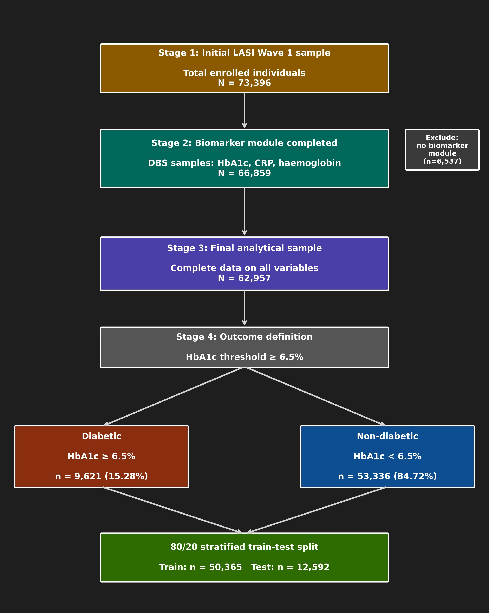
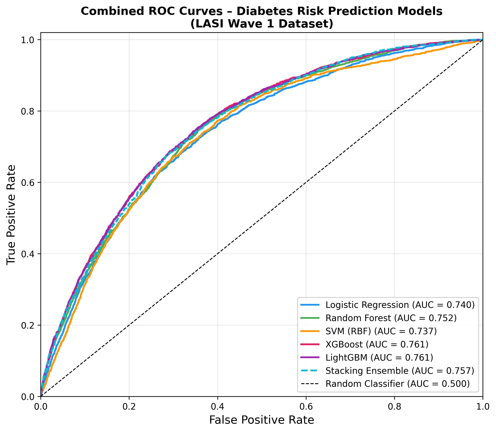
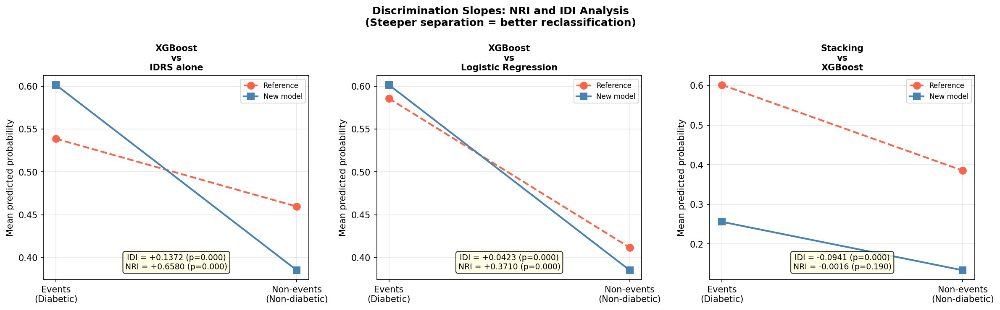
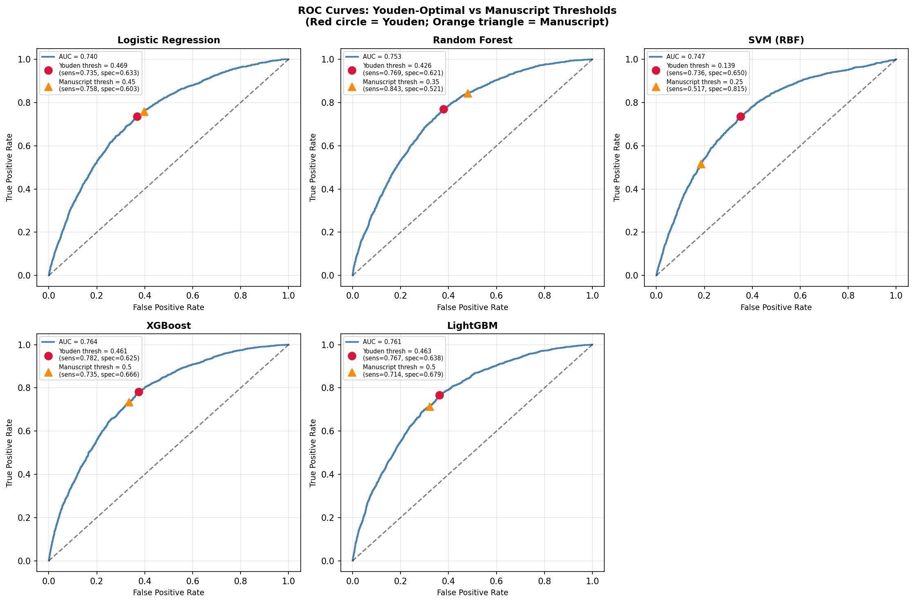
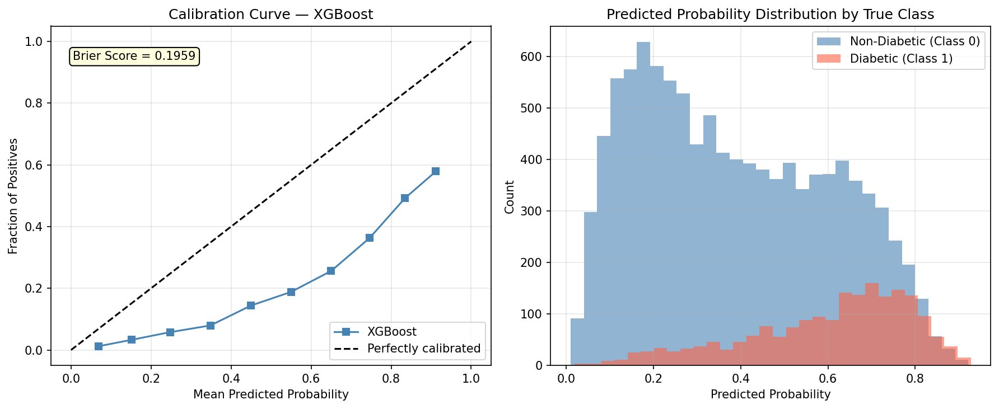
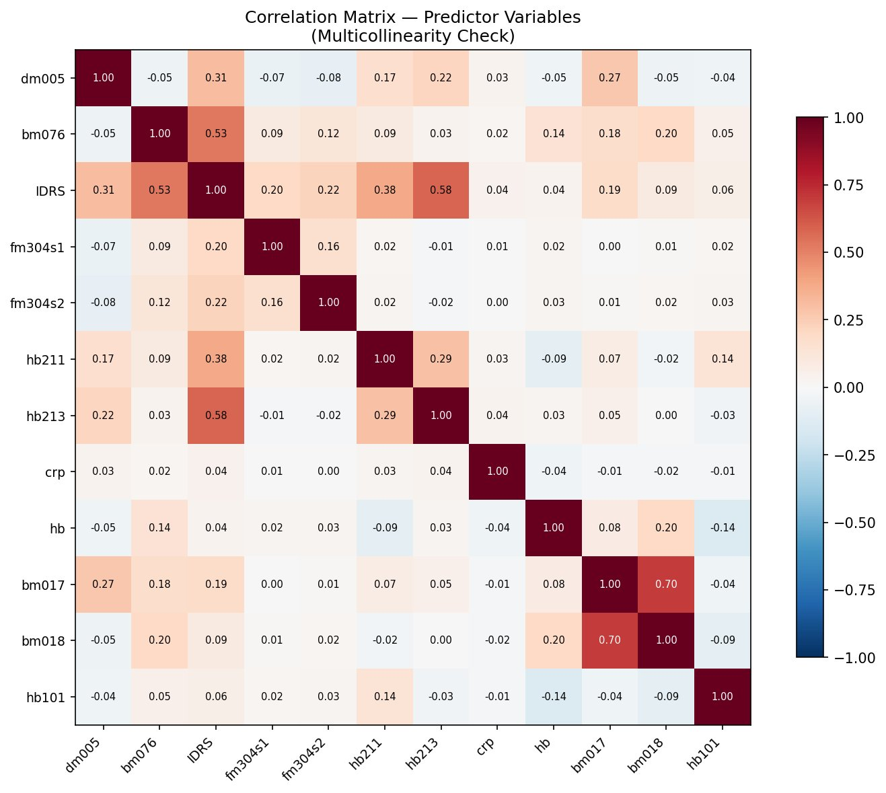
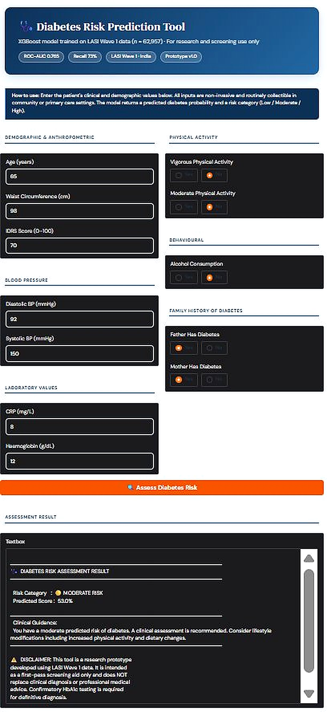

# Diabetes Risk Prediction in Older Indian Adults — Explainable ML Pipeline

An explainable machine learning pipeline for predicting diabetes risk among older adults in India, built on Wave 1 of the **Longitudinal Ageing Study in India (LASI)** and externally validated on **NHANES**. The best-performing model (XGBoost) is deployed as an interactive screening tool using **Gradio**.

🔗 **Live demo:** [Hugging Face Spaces](https://huggingface.co/spaces/bhava10/Diabetes_risk_prediction)

---

## Overview

Diabetes remains substantially under-diagnosed among older adults in India, and laboratory-based screening (HbA1c, OGTT, FPG) is often inaccessible in rural and peri-urban settings. This project develops and compares six supervised ML classifiers to predict diabetes risk (HbA1c ≥ 6.5%) using only non-invasive, routinely collectible variables.

### Sample flow



### Key results (test set, n = 12,592)

| Model | ROC-AUC (bootstrap) | Sensitivity | Specificity |
|---|---|---|---|
| **XGBoost** (best, deployed) | **0.769** (95% CI 0.758–0.780) | 0.732 | 0.672 |
| Stacking Ensemble | 0.768 (0.757–0.779) | 0.700 | 0.704 |
| LightGBM | 0.765 (0.755–0.776) | 0.718 | 0.683 |
| Random Forest | 0.757 (0.746–0.769) | 0.842 | 0.534 |
| Logistic Regression | 0.744 (0.733–0.755) | 0.753 | 0.606 |
| SVM (RBF) | 0.742 (0.731–0.754) | 0.526 | 0.814 |

*(See `results/all_models_ci.csv` and `results/bootstrap_ci_xgboost.csv` for full detail.)*



- **XGBoost vs IDRS alone:** IDI = +0.137, continuous NRI = +0.658 (both p < 0.001) — see `results/nri_idi_results.csv`
- **External validation (NHANES):** ROC-AUC = 0.69, sensitivity = 49.8% (attenuation expected — IDRS unavailable in NHANES, plus cross-population distributional differences)



---

## Repository Structure

This repo intentionally includes **only the XGBoost pipeline** (the best-performing, deployed model), the Gradio app, and the result tables/figures that support it. All other model-training and multi-model comparison scripts (Logistic Regression, Random Forest, SVM, LightGBM, Stacking Ensemble, and the analysis scripts that train them for comparison — hyperparameter search, Youden thresholds, NRI/IDI, DCA) are kept privately by the author and are not part of this repo.

```
diabetes-risk-prediction/
├── README.md
├── LICENSE
├── requirements.txt
├── .gitignore
├── data/
│   └── README.md                       # data access + data-use-agreement notes (no raw data committed)
├── src/
│   └── models/
│       └── xgb.py                      # XGBoost — final deployed model + SHAP analysis
├── results/                            # derived/aggregated result tables (see note below)
│   ├── hyperparameters_all_models.csv
│   ├── bootstrap_ci_xgboost.csv
│   ├── all_models_ci.csv
│   ├── idrs_comparison.csv
│   ├── subgroup_performance.csv
│   ├── youden_threshold_comparison.csv
│   ├── nri_idi_results.csv
│   ├── groupkfold_summary.csv
│   ├── nhanes_validation_results.csv
│   └── all_results_summary.txt
├── figures/
│   ├── LASI_Diabetes_Flowchart.png
│   ├── combined_roc_curve.png
│   ├── youden_threshold_comparison.png
│   ├── calibration_plot_xgboost.png
│   ├── correlation_matrix.png
│   ├── nri_idi_slopes.png
│   └── gradio_figure_enhanced.png
├── models/
│   └── README.md                       # how to regenerate / where to store the trained model
└── app/
    └── app.py                          # Gradio interface (same as the deployed HF Space)
```

> **Note:** `results/` still reports comparisons against the other five models (e.g. XGBoost vs IDRS, vs Logistic Regression) because that comparison is part of the published methodology and justifies why XGBoost was selected — but the code that generated those numbers is not included here.

> **⚠️ Note on `results/`:** A few of these CSVs (`youden_threshold_comparison.csv`, `nri_idi_results.csv`, `groupkfold_summary.csv`, `nhanes_validation_results.csv`) were reconstructed from values printed on the chart figures and in the manuscript text, **not** read from the original CSV files — those specific files weren't available to copy directly. Numbers should match, but if you have the originals, replace these with the source files. `groupkfold_summary.csv` in particular only has the aggregate stats (mean ± SD), not the exact per-fold table. `missing_per_variable.csv` could not be reconstructed at all (no values were available anywhere).

---

## Dataset

- **LASI Wave 1 (2017–18):** Nationally representative survey of Indian adults aged 45+ (n = 73,396 enrolled; n = 62,957 in the final analytical sample). Available via [IIPS](https://iipsindia.ac.in/content/LASI-data) upon request/approval. **Not redistributed here** — see `data/README.md`.
- **NHANES:** Used for external validation. Publicly available from the [CDC](https://www.cdc.gov/nchs/nhanes).

## Predictor Variables

Age, waist circumference, systolic/diastolic blood pressure, CRP, haemoglobin, physical activity (vigorous/moderate), alcohol consumption, paternal/maternal diabetes history, and the Indian Diabetes Risk Score (IDRS).

## Methods Summary

- **Outcome:** HbA1c ≥ 6.5% (binary)
- **Preprocessing:** median/mode imputation, one-hot encoding, z-score scaling (LR/SVM only), log-transformed CRP
- **Class imbalance:** `class_weight="balanced"` / `scale_pos_weight`
- **Model selection:** GridSearchCV, 5-fold stratified CV, ROC-AUC as primary metric
- **Sensitivity analyses:** Youden-optimal thresholds, PSU-clustered GroupKFold, survey-weight comparison, NRI/IDI vs IDRS
- **Interpretability:** SHAP (TreeExplainer) on the refitted XGBoost model
- **External validation:** Pre-trained XGBoost pipeline applied directly to a harmonised NHANES subset (no re-training/recalibration)
- **Deployment:** Gradio web app, served on Hugging Face Spaces





## Installation

```bash
git clone https://github.com/<your-username>/diabetes-risk-prediction.git
cd diabetes-risk-prediction
pip install -r requirements.txt
```

## Usage

```bash
# Train the deployed XGBoost model (+ SHAP analysis)
# Requires a preprocessed analytical dataset — see data/README.md
python src/models/xgb.py

# Launch the Gradio app locally (needs models/xgboost_pipeline.joblib — see models/README.md)
python app/app.py
```

## Prototype Tool



| Risk Category | Predicted Probability | Recommended Action |
|---|---|---|
| Low | < 0.30 | Routine monitoring |
| Moderate | 0.30 – 0.60 | Further clinical assessment |
| High | ≥ 0.60 | Urgent referral for confirmatory HbA1c testing |

⚠️ **Disclaimer:** This is a research prototype. It has not undergone formal clinical validation or regulatory review and must not substitute for clinical assessment or diagnostic testing.

## Citation

If you use this work, please cite:

> Bhavatharani B, Britney Maria Faustina P, Harish Siva Balaji M, Dharia B, Deepika K, Mahalakshmi R, Jemmy Christy H. *An Explainable Machine Learning Approach for Diabetes Risk Prediction Among Older Adults in India.* Department of Bioinformatics, Sathyabama Institute of Science and Technology, Chennai, India.

## License

Released under the [MIT License](LICENSE) (update author names, or replace with your journal's preferred license).

## Acknowledgements

IIPS, Ministry of Health and Family Welfare (Government of India), Harvard T.H. Chan School of Public Health, and the University of Southern California for the LASI Wave 1 survey; CDC/NCHS for NHANES.
